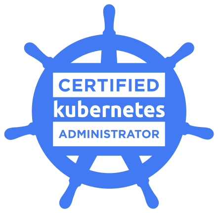
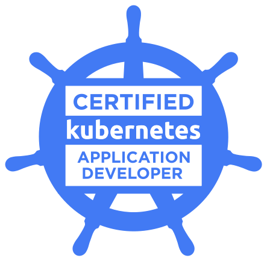
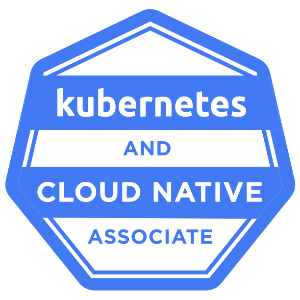
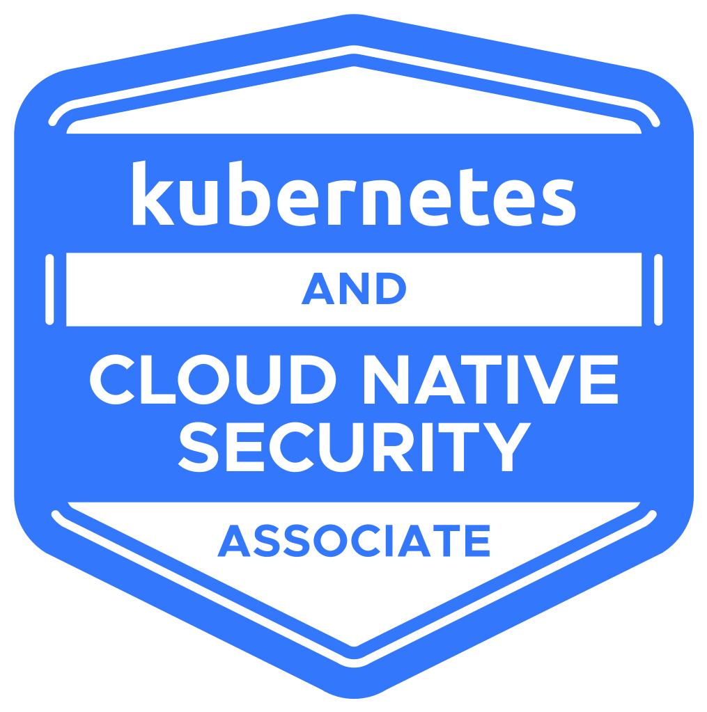
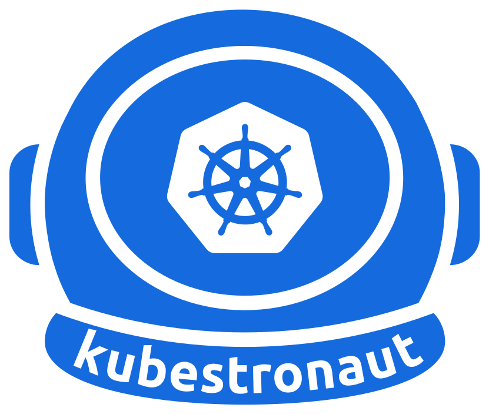

<h1>Black Friday & Cyber Monday 2026 Deals for Engineers</h1>

<b>Hand-picked deals on learning platforms, books, certifications, hosting and creator tools</b> 
for DevOps, SRE, Platform, MLOps and software engineers. Sorted by category and kept up to date through the sale.

<!-- STATS:START -->

   
<!-- STATS:END -->

---

## ⭐ Top picks

Our favourite deals this year for everyone working in **DevOps, Cloud, Kubernetes, SRE, Platform Engineering and MLOps**.

<!-- TOP-PICKS:START -->
<table>
  <tr>
    <td align="center" width="25%">
       
      <a href="https://tidd.ly/3Uc4okA"><ins><b>Linux Foundation Certifications</b></ins></a> 
      <b>40%&nbsp;off&nbsp;sitewide</b>  
      🎟️&nbsp;<code><b>40KUBE26CT</b></code>
    </td>
    <td align="center" width="25%">
       
      <a href="https://tidd.ly/3YXTyO3?ref=devopscube.com"><ins><b>KodeKloud</b></ins></a> 
      🔥&nbsp;<b>50%&nbsp;off</b>  
      
    </td>
    <td align="center" width="25%">
       
      <a href="https://devopscube.com/recommends/udacity-plans/"><ins><b>Udacity</b></ins></a> 
      🔥&nbsp;<b>Up&nbsp;to&nbsp;55%&nbsp;off</b>  
      
    </td>
    <td align="center" width="25%">
       
      <a href="https://bytebytego.com/?fpr=devopscube&ref=devopscube.com"><ins><b>ByteByteGo</b></ins></a> 
      🔥&nbsp;<b>50% off annual plans</b>  
      
    </td>
  </tr>
  <tr>
    <td align="center" width="25%">
       
      <a href="https://devopscube.com/recommends/pluralsight-free-trial/"><ins><b>Pluralsight & A Cloud Guru</b></ins></a> 
      🔥&nbsp;<b>60% off annual plans</b>  
      
    </td>
    <td align="center" width="25%">
       
      <a href="https://devopscube.com/recommends/educative/"><ins><b>Educative</b></ins></a> 
      🔥&nbsp;<b>55% off Unlimited plans</b>  
      
    </td>
    <td align="center" width="25%">
       
      <a href="https://courses.devopscube.com/?ref=devopscube.com"><ins><b>DevOpsCube Courses</b></ins></a> 
      <b>Up&nbsp;to&nbsp;40%&nbsp;off</b>  
      🎟️&nbsp;<code><b>FLASH40</b></code>
    </td>
    <td align="center" width="25%">
       
      <a href="https://devopscube.com/recommends/cloudways/"><ins><b>Cloudways</b></ins></a> 
      🔥&nbsp;<b>80%&nbsp;off</b>  
      🎟️&nbsp;<code><b>BFCM802</b></code>
    </td>
  </tr>
</table>
<!-- TOP-PICKS:END -->

## 💡 Smart shopping tips

<table>
  <tr>
    <td width="33%" valign="top">
      <h3>📅 Go annual</h3>
      The biggest discounts are on yearly plans. Lock in the price before the deal ends.
    </td>
    <td width="33%" valign="top">
      <h3>🔁 Check renewal prices</h3>
      Hosting deals often renew at full price after the first term. Read the fine print.
    </td>
    <td width="33%" valign="top">
      <h3>🎟️ Stack the coupon</h3>
      Linux Foundation codes work on top of bundle prices. That's where the biggest savings are.
    </td>
  </tr>
  <tr>
    <td width="33%" valign="top">
      <h3>📦 Bundle your exams</h3>
      Planning CKA and CKAD this year? A bundle plus the coupon costs far less than two single exams.
    </td>
    <td width="33%" valign="top">
      <h3>🎯 Buy what you'll use</h3>
      A 50% discount on a course you never open is still money lost. Pick one goal.
    </td>
    <td width="33%" valign="top">
      <h3>⭐ Star this repo</h3>
      We update deals as they go live. Star or watch the repo so you don't miss one.
    </td>
  </tr>
</table>

## 🗂️ Browse by category

<!-- NAV:START -->
<table>
  <tr>
    <td align="center" width="20%">
      <a href="#learning-platforms">🎓 <b>Learning Platforms</b></a> 
      14 deals
    </td>
    <td align="center" width="20%">
      <a href="#books-reading">📚 <b>Books & Reading</b></a> 
      3 deals
    </td>
    <td align="center" width="20%">
      <a href="#certifications">📜 <b>Certifications</b></a> 
      15 deals
    </td>
    <td align="center" width="20%">
      <a href="#hosting-platforms">🌐 <b>Hosting Platforms</b></a> 
      10 deals
    </td>
    <td align="center" width="20%">
      <a href="#creator-tools">🎬 <b>Creator Tools</b></a> 
      5 deals
    </td>
  </tr>
</table>
<!-- NAV:END -->

🟢 <b>Live</b>: deal is active now &nbsp;·&nbsp;
⏳ <b>Soon</b>: 👀 Black Friday offer not announced yet &nbsp;·&nbsp;
⛔ <b>Expired</b> &nbsp;·&nbsp;
🔥 <b>50% off or more</b>

<!-- DEALS:START -->

## 🎓 Learning Platforms

Black Friday is the cheapest time of the year to level up. These platforms cover everything from Linux and Kubernetes labs to cloud certification prep, system design and interview practice. Most of the big savings are on annual plans, so pick the one that matches where you are in your DevOps, SRE, Platform or MLOps journey.

| Platform | Description | Deal | Coupon / Link | Status |
|:--|:--|:--|:-:|:-:|
| &nbsp;<a href="https://tidd.ly/3YXTyO3?ref=devopscube.com"><ins><b>KodeKloud</b></ins></a> | Hands-on DevOps, Kubernetes and cloud courses with in-browser labs | 🔥&nbsp;<b>50%&nbsp;off</b> |  | 🟢&nbsp;Live |
| &nbsp;<a href="https://devopscube.com/recommends/udacity-plans/"><ins><b>Udacity</b></ins></a> | Nanodegree programs in cloud, AI and data engineering | 🔥&nbsp;<b>Up&nbsp;to&nbsp;55%&nbsp;off</b> |  | 🟢&nbsp;Live |
| &nbsp;<a href="https://bytebytego.com/?fpr=devopscube&ref=devopscube.com"><ins><b>ByteByteGo</b></ins></a> | Visual system design courses and guides for interviews and real work | 🔥&nbsp;<b>50% off annual plans</b> |  | 🟢&nbsp;Live |
| &nbsp;<a href="https://devopscube.com/recommends/pluralsight-free-trial/"><ins><b>Pluralsight & A Cloud Guru</b></ins></a> | Cloud and DevOps skills plus AWS, Azure and GCP certification prep | 🔥&nbsp;<b>60% off annual plans</b> |  | 🟢&nbsp;Live |
| &nbsp;<a href="https://devopscube.com/recommends/educative/"><ins><b>Educative</b></ins></a> | Interactive text-based courses with in-browser coding | 🔥&nbsp;<b>55% off Unlimited plans</b> |  | 🟢&nbsp;Live |
| &nbsp;<a href="https://devopscube.com/recommends/datacamp-special-promo/"><ins><b>DataCamp</b></ins></a> | Data, AI and MLOps skills with hands-on projects | 🔥&nbsp;<b>50% off annual plans</b> |  | 🟢&nbsp;Live |
| &nbsp;<a href="https://courses.devopscube.com/?ref=devopscube.com"><ins><b>DevOpsCube Courses</b></ins></a> | Practical Kubernetes and DevOps courses from the DevOpsCube team | <b>Up&nbsp;to&nbsp;40%&nbsp;off</b> | 🎟️&nbsp;<code><b>FLASH40</b></code> | 🟢&nbsp;Live |
| &nbsp;<a href="https://imp.i384100.net/QOoeKa"><ins><b>Coursera</b></ins></a> | University and industry courses and professional certificates | 👀&nbsp;<i>Not announced yet</i> |  | ⏳&nbsp;Soon |
| &nbsp;<a href="https://trk.udemy.com/19nVVa"><ins><b>Udemy</b></ins></a> | Low-cost video courses on almost every DevOps tool | 👀&nbsp;<i>Not announced yet</i> |  | ⏳&nbsp;Soon |
| &nbsp;<a href="https://www.aced.io/?ref=n2u2mmm"><ins><b>Aced (formerly Exponent)</b></ins></a> | Tech interview courses, real questions and mock interviews | 👀&nbsp;<i>Not announced yet</i> |  | ⏳&nbsp;Soon |
| &nbsp;<a href="https://codemia.io?via=devopscube"><ins><b>Codemia</b></ins></a> | System design practice with AI feedback on 120+ problems | 👀&nbsp;<i>Not announced yet</i> |  | ⏳&nbsp;Soon |
| &nbsp;<a href="https://www.designgurus.io/"><ins><b>Design Gurus</b></ins></a> | System design and coding interview courses from ex-FAANG hiring managers | 👀&nbsp;<i>Not announced yet</i> |  | ⏳&nbsp;Soon |
| &nbsp;<a href="https://algo.monster/"><ins><b>AlgoMonster</b></ins></a> | Coding interview patterns with a structured, AI-assisted curriculum | 👀&nbsp;<i>Not announced yet</i> |  | ⏳&nbsp;Soon |
| &nbsp;<a href="https://skillshare.eqcm.net/RKv32"><ins><b>Skillshare</b></ins></a> | Classes on design, video and soft skills | 👀&nbsp;<i>Not announced yet</i> |  | ⏳&nbsp;Soon |

<a href="#categories">⬆ Back to categories</a>

## 📚 Books & Reading

Books are still the best way to go deep on a topic. Stock up on DevOps, Kubernetes, cloud, SRE and system design titles from the tech publishers engineers trust most.

| Platform | Description | Deal | Coupon / Link | Status |
|:--|:--|:--|:-:|:-:|
| &nbsp;<a href="https://oreillymedia.pxf.io/g1mgj0"><ins><b>O'Reilly</b></ins></a> | Tech books, videos and live training from top publishers | 👀&nbsp;<i>Not announced yet</i> |  | ⏳&nbsp;Soon |
| &nbsp;<a href="https://www.manning.com/"><ins><b>Manning</b></ins></a> | In-depth programming and DevOps books with the liveBook online reader | 👀&nbsp;<i>Not announced yet</i> |  | ⏳&nbsp;Soon |
| &nbsp;<a href="https://www.packtpub.com/"><ins><b>Packt</b></ins></a> | Practical DevOps, cloud and AI books and videos | 👀&nbsp;<i>Not announced yet</i> |  | ⏳&nbsp;Soon |

<a href="#categories">⬆ Back to categories</a>

## 📜 Certifications

Prove your skills with a certification. The Linux Foundation runs its biggest sale of the year now, and bundles save the most.

### ☸️ Kubernetes Certifications

> Single exams from the CNCF Kubernetes track, from entry level to expert.

| Platform | Description | Deal | Coupon / Link | Status |
|:--|:--|:--|:-:|:-:|
|  <a href="https://tidd.ly/3Uc4okA"><ins><b>CKA</b></ins></a> | Certified Kubernetes Administrator. Set up, run and troubleshoot clusters | <b>40%&nbsp;off</b> | 🎟️&nbsp;<code><b>40KUBE26CT</b></code> | 🟢&nbsp;Live |
|  <a href="https://tidd.ly/3Uc4okA"><ins><b>CKAD</b></ins></a> | Certified Kubernetes Application Developer. Build and deploy apps on Kubernetes | <b>40%&nbsp;off</b> | 🎟️&nbsp;<code><b>40KUBE26CT</b></code> | 🟢&nbsp;Live |
|  <a href="https://tidd.ly/3Uc4okA"><ins><b>CKS</b></ins></a> | Certified Kubernetes Security Specialist. Secure clusters and workloads (needs CKA) | <b>40%&nbsp;off</b> | 🎟️&nbsp;<code><b>40KUBE26CT</b></code> | 🟢&nbsp;Live |
|  <a href="https://tidd.ly/3Uc4okA"><ins><b>KCNA</b></ins></a> | Kubernetes and Cloud Native Associate. The entry-level cloud-native exam | <b>40%&nbsp;off</b> | 🎟️&nbsp;<code><b>40KUBE26CT</b></code> | 🟢&nbsp;Live |
|  <a href="https://tidd.ly/3Uc4okA"><ins><b>KCSA</b></ins></a> | Kubernetes and Cloud Native Security Associate. Entry-level security exam | <b>40%&nbsp;off</b> | 🎟️&nbsp;<code><b>40KUBE26CT</b></code> | 🟢&nbsp;Live |

### 📦 Certification Bundles

> Planning more than one exam? Bundles already cost less, and the coupon works on top for up to 47% off.

| Platform | Description | Deal | Coupon / Link | Status |
|:--|:--|:--|:-:|:-:|
| &nbsp; <a href="https://tidd.ly/3Uc4okA"><ins><b>CKA + CKAD</b></ins></a> | Admin and developer. The most popular Kubernetes pair | <b>Up&nbsp;to&nbsp;47%&nbsp;off</b> | 🎟️&nbsp;<code><b>40KUBE26CT</b></code> | 🟢&nbsp;Live |
| &nbsp; <a href="https://tidd.ly/3Uc4okA"><ins><b>CKA + CKS</b></ins></a> | Admin and security specialist | <b>Up&nbsp;to&nbsp;47%&nbsp;off</b> | 🎟️&nbsp;<code><b>40KUBE26CT</b></code> | 🟢&nbsp;Live |
| &nbsp;&nbsp; <a href="https://tidd.ly/3Uc4okA"><ins><b>CKA + CKAD + CKS</b></ins></a> | All three professional Kubernetes exams | <b>Up&nbsp;to&nbsp;47%&nbsp;off</b> | 🎟️&nbsp;<code><b>40KUBE26CT</b></code> | 🟢&nbsp;Live |
| &nbsp; <a href="https://tidd.ly/3Uc4okA"><ins><b>KCNA + CKA</b></ins></a> | Start with the associate exam, then go for the admin cert | <b>Up&nbsp;to&nbsp;47%&nbsp;off</b> | 🎟️&nbsp;<code><b>40KUBE26CT</b></code> | 🟢&nbsp;Live |
| &nbsp; <a href="https://tidd.ly/3Uc4okA"><ins><b>KCSA + CKS</b></ins></a> | Security associate plus security specialist | <b>Up&nbsp;to&nbsp;47%&nbsp;off</b> | 🎟️&nbsp;<code><b>40KUBE26CT</b></code> | 🟢&nbsp;Live |
| &nbsp; <a href="https://tidd.ly/3Uc4okA"><ins><b>KCNA + KCSA</b></ins></a> | Both associate-level exams | <b>Up&nbsp;to&nbsp;47%&nbsp;off</b> | 🎟️&nbsp;<code><b>40KUBE26CT</b></code> | 🟢&nbsp;Live |

### 🚀 Kubestronaut

> Pass all five Kubernetes certs to become a Kubestronaut, or pass all 16 to earn the Golden Kubestronaut title.

| Platform | Description | Deal | Coupon / Link | Status |
|:--|:--|:--|:-:|:-:|
|  <a href="https://tidd.ly/3Uc4okA"><ins><b>Kubestronaut Bundle</b></ins></a> | CKA, CKAD, CKS, KCNA and KCSA. All 5 exams for the Kubestronaut title | <b>Up&nbsp;to&nbsp;47%&nbsp;off</b> | 🎟️&nbsp;<code><b>40KUBE26CT</b></code> | 🟢&nbsp;Live |
|  <a href="https://tidd.ly/3Uc4okA"><ins><b>Golden Kubestronaut Bundle</b></ins></a> | All 16 CNCF and LF certs, including PCA, ICA, CAPA and LFCS | <b>About 48% off (bundle price + code)</b> ⌛ Ends Nov 20 | 🎟️&nbsp;<code><b>DCUBE30</b></code> | 🟢&nbsp;Live |

### 🐧 Linux & Other Certifications

> Every other Linux Foundation exam and course, plus short skill certs.

| Platform | Description | Deal | Coupon / Link | Status |
|:--|:--|:--|:-:|:-:|
| &nbsp;<a href="https://tidd.ly/3Uc4okA"><ins><b>Linux Foundation Certifications</b></ins></a> | LFCS, PCA, ICA, CAPA and every other LF cert, plus courses | <b>40%&nbsp;off&nbsp;sitewide</b> | 🎟️&nbsp;<code><b>40KUBE26CT</b></code> | 🟢&nbsp;Live |
| &nbsp;<a href="https://tidd.ly/3Uc4okA"><ins><b>Linux Foundation SkillCreds</b></ins></a> | Short skill certs for Git, Bash, Helm, YAML and Vim | <b>Up&nbsp;to&nbsp;30%&nbsp;off</b> | 🎟️&nbsp;<code><b>SCRIPT30</b></code> | 🟢&nbsp;Live |

📖 **[Full Linux Foundation coupon guide](https://devopscube.com/linux-foundation-coupon/)**: every code, bundle and saving explained.

<a href="#categories">⬆ Back to categories</a>

## 🌐 Hosting Platforms

Run your tech blog, portfolio, demo app or side project. Hosting has some of the deepest discounts of the year, but they usually apply to the first term only, so check the renewal price before you pick a long plan.

| Platform | Description | Deal | Coupon / Link | Status |
|:--|:--|:--|:-:|:-:|
| &nbsp;<a href="https://devopscube.com/recommends/cloudways/"><ins><b>Cloudways</b></ins></a> | Managed cloud hosting on DigitalOcean, AWS, Google Cloud and more | 🔥&nbsp;<b>80%&nbsp;off</b> | 🎟️&nbsp;<code><b>BFCM802</b></code> | 🟢&nbsp;Live |
| &nbsp;<a href="https://comtechies.com/recommends/hostinger-2?ref=devopscube.com"><ins><b>Hostinger</b></ins></a> | Budget-friendly web and WordPress hosting | 🔥&nbsp;<b>Up&nbsp;to&nbsp;83%&nbsp;off</b> |  | 🟢&nbsp;Live |
| &nbsp;<a href="https://comtechies.com/recommends/httpswwwa2hostingcomaid67af0c96b259cbid75dbf1c0?ref=devopscube.com"><ins><b>Hosting.com (formerly A2 Hosting)</b></ins></a> | Shared, WordPress and managed hosting | 🔥&nbsp;<b>Up&nbsp;to&nbsp;87%&nbsp;off</b> |  | 🟢&nbsp;Live |
| &nbsp;<a href="https://chemicloud.com/?ref=devopscube.com#68e6451055163"><ins><b>ChemiCloud</b></ins></a> | Managed WordPress and shared hosting | 🔥&nbsp;<b>Up&nbsp;to&nbsp;84%&nbsp;off</b> |  | 🟢&nbsp;Live |
| &nbsp;<a href="https://click.dreamhost.com/aff_c?offer_id=8&aff_id=21910"><ins><b>DreamHost</b></ins></a> | Shared, VPS and WordPress hosting | 🔥&nbsp;<b>Up&nbsp;to&nbsp;83%&nbsp;off</b> |  | 🟢&nbsp;Live |
| &nbsp;<a href="https://www.scalahosting.com/?ref=devopscube.com#jorgearagao"><ins><b>Scala Hosting</b></ins></a> | Managed VPS hosting with the SPanel control panel | 🔥&nbsp;<b>Up&nbsp;to&nbsp;78%&nbsp;off</b> |  | 🟢&nbsp;Live |
| &nbsp;<a href="https://comtechies.com/recommends/httpspartnersinmotionhostingcomc56122972600334222?ref=devopscube.com"><ins><b>InMotion Hosting</b></ins></a> | Shared, VPS and dedicated hosting | 🔥&nbsp;<b>Up&nbsp;to&nbsp;77%&nbsp;off</b> |  | 🟢&nbsp;Live |
| &nbsp;<a href="https://comtechies.com/recommends/hostgator?ref=devopscube.com"><ins><b>HostGator</b></ins></a> | Shared and WordPress hosting | 🔥&nbsp;<b>Up&nbsp;to&nbsp;76%&nbsp;off</b> |  | 🟢&nbsp;Live |
| &nbsp;<a href="https://comtechies.com/recommends/bluehost?ref=devopscube.com"><ins><b>Bluehost</b></ins></a> | Shared and WordPress hosting | 🔥&nbsp;<b>Up&nbsp;to&nbsp;62%&nbsp;off</b> |  | 🟢&nbsp;Live |
| &nbsp;<a href="https://squarespace.syuh.net/9Va5X0"><ins><b>Squarespace</b></ins></a> | All-in-one website builder with hosting included | 👀&nbsp;<i>Not announced yet</i> |  | ⏳&nbsp;Soon |

<a href="#categories">⬆ Back to categories</a>

## 🎬 Creator Tools

Writing and teaching what you know is one of the best ways to grow as an engineer. A tech blog, a newsletter or a course shows your skills to recruiters and the community, and helps you build an audience. These tools make it easy to start.

| Platform | Description | Deal | Coupon / Link | Status |
|:--|:--|:--|:-:|:-:|
| &nbsp;<a href="https://www.beehiiv.com/?via=devopscube&ref=devopscube.com"><ins><b>Beehiiv</b></ins></a> | Newsletter platform built for growth | <b>Up&nbsp;to&nbsp;20%&nbsp;off</b> | 🎟️&nbsp;<code><b>DCUBE20OFF</b></code> | 🟢&nbsp;Live |
| &nbsp;<a href="https://ghost.org/?via=bibin75&ref=devopscube.com"><ins><b>Ghost</b></ins></a> | Open-source blogging and newsletter platform | <b>Up to 20% off annual plans</b> |  | 🟢&nbsp;Live |
| &nbsp;<a href="https://devopscube.com/recommends/teachable-pricing/"><ins><b>Teachable</b></ins></a> | Create and sell online courses | <b>Up&nbsp;to&nbsp;30%&nbsp;off</b> |  | 🟢&nbsp;Live |
| &nbsp;<a href="https://techsmith.z6rjha.net/rP3VB"><ins><b>TechSmith (Camtasia & Snagit)</b></ins></a> | Screen recording and screenshots for tutorials and demos | 👀&nbsp;<i>Not announced yet</i> |  | ⏳&nbsp;Soon |
| &nbsp;<a href="https://try.elevenlabs.io/p4fh9dhwbmjw?ref=devopscube.com"><ins><b>ElevenLabs</b></ins></a> | AI voice-over for course videos and demos | 🔥&nbsp;<b>Up&nbsp;to&nbsp;50%&nbsp;off</b> |  | 🟢&nbsp;Live |

<a href="#categories">⬆ Back to categories</a>

<!-- DEALS:END -->

---

## 🤝 Add or update a deal

Found a great deal for DevOps, SRE or MLOps engineers? We'd love to add it.

- **Easy way:** [open a deal request](../../issues/new?template=submit-deal.yml) and fill in the form. No code needed.
- **Pull request:** add the deal to [`deals.yml`](deals.yml), run `python scripts/build_readme.py`, and open a PR.

See [CONTRIBUTING.md](CONTRIBUTING.md) for the full guide.

## 📢 Disclosure

Some links in this list are affiliate or partner links. If you buy through them, DevOpsCube may earn a small commission **at no extra cost to you**. It helps us keep this list and our free DevOps content going. We only list tools and platforms we think are useful for engineers.

Prices and offers are set by each vendor and can change or end without notice. Always check the final price on the vendor's checkout page.

---

**If this list saved you money, give it a ⭐ so other engineers can find it.**

Made with ❤️ by the <a href="https://devopscube.com">DevOpsCube</a> team

